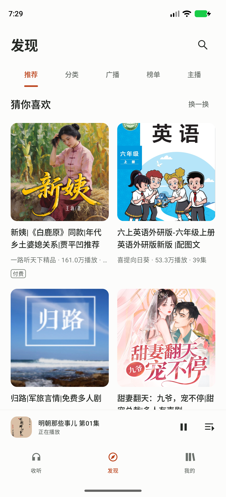
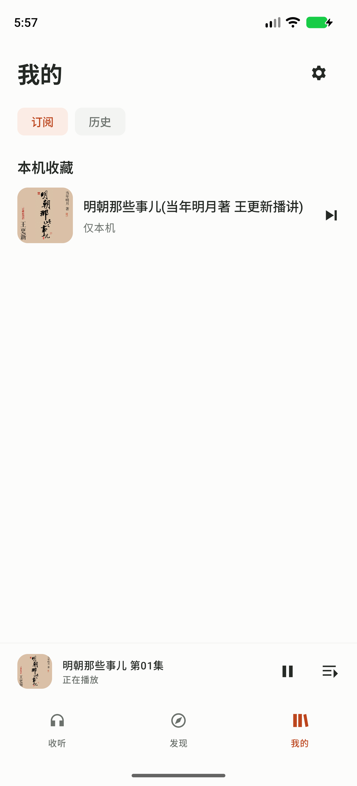
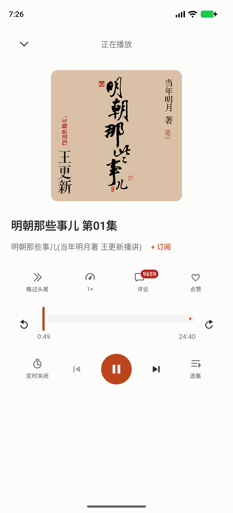
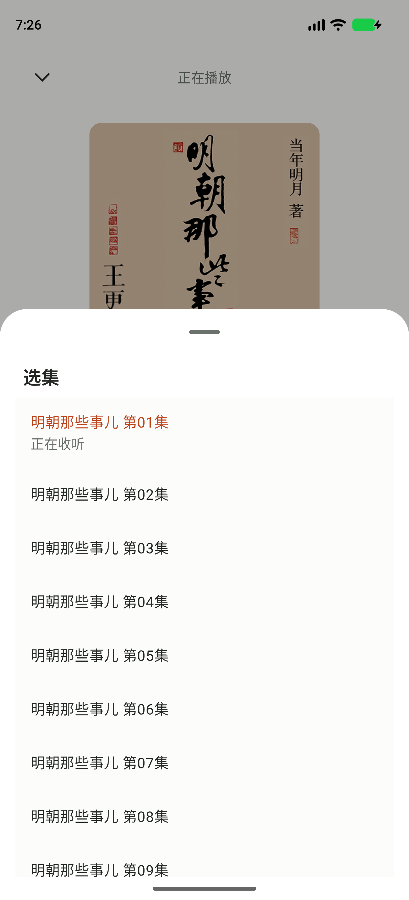

# Ximalaya Lite

喜马拉雅第三方 Android 客户端。去掉广告和与收听无关的功能，保留简单的听书体验。

## 截图

| 发现 | 本机收藏 |
| :---: | :---: |
|  |  |

| 播放器 | 选集 | 评论 |
| :---: | :---: | :---: |
|  |  |  |

## 与原版的区别

- **去广告**：没有开屏广告、广告横幅和营销弹窗。
- **精简功能**：不提供礼物打赏、充值和支付入口，专注在线收听；广播中的直播间仅保留收听。
- **简化界面**：收听、发现、我的三个页面，常用播放操作集中在播放器中。

保留搜索、订阅、历史同步、连续播放、倍速、定时、跳过头尾，以及点赞和评论。暂不支持离线下载。

本项目非官方应用。**充值、会员开通与续费、付费内容购买需前往官方 App 完成**，本应用不提供任何购买入口；会员及付费内容仍需相应账号权益。音频内容本身包含的广告不在界面去广告范围内。

## 安装

支持 Android 8.0 及以上的 arm64 设备。

`v0.1.0` 起使用独立发布签名。安装过旧测试包的用户需要先卸载旧包；卸载会清除本机记录和设置。后续发布版可直接覆盖升级。

## 从源码构建

需要 JDK 21 和 Android SDK 37。配置 `ANDROID_HOME`，或在 `local.properties` 中指定 SDK 路径，然后执行：

```sh
./gradlew :app:assembleDebug
```

生成的安装包位于 `app/build/outputs/apk/debug/app-debug.apk`。

## 许可

本项目原创代码采用 [AGPL-3.0](LICENSE)。第三方依赖及原生组件的权利归属见[第三方组件说明](THIRD_PARTY_NOTICES.md)。
